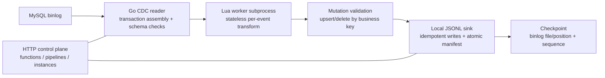

# go-cdc-etl

Programmable CDC pipelines in Go: continuously read MySQL binlog, hand committed changes to user-defined transforms, and sink the results with exactly-tracked progress.

This repository is built in stages. The long-term goal is a multi-tenant platform where users bring a source, transform code, and a destination — starting with MySQL and S3 — with isolation, retries, and consumption progress handled by the platform (see the [design](docs/design.md)). **The code delivered today is the local MVP stage**: the sink is local disk, the runtime is a single process, and transforms run in isolated Lua worker subprocesses. The name "local MVP" describes this stage, not the ceiling of the project.

## Features

Current capabilities (the local MVP):

- Real MySQL binlog consumption with transaction assembly and schema checks (ROW / FULL, InnoDB base tables, fixed table subscriptions)
- User-defined transforms in Lua: stateless per-event functions with an exact-decimal SDK, executed in time-boxed worker subprocesses
- Business-key upsert/delete applied to outputs; one event can fan out to multiple outputs
- Multiple pipelines and outputs, with persistent checkpoints, pause/resume, and recovery across process restarts
- Idempotent, atomic commits: transaction-ID content addressing + manifest publication + file checksums — no half-visible intermediate state
- HTTP control plane: functions, pipeline drafts/versions, instance lifecycle, idempotent submission, and output inspection ([OpenAPI](api/openapi.json))

Explicitly **not** implemented yet (tracked in the [roadmap](docs/roadmap.md)): Iceberg/Parquet/S3 sinks, initial full load, CDC reconnect with backoff, GTID, multi-tenant isolation, distributed scheduling, WASM backends, and resource-limited (memory) sandboxing.

## Getting Started

Requires Go 1.26+, Docker Compose, curl, and Python 3. All commands are run from the project root.

```bash
make mysql-up
make build
ETL_MYSQL_PASSWORD=etl-demo-password ./bin/etl serve
```

HTTP binds to `127.0.0.1:8080` by default; MySQL runs as a separate Compose container on `127.0.0.1:13306`. The initial account and password are for local demo use only.

In another terminal, create a function, publish a pipeline, and start an instance:

```bash
./scripts/demo.sh
```

Then write data to `shop.orders` and query the output by the returned `instance_id`. Full steps, API semantics, and the scope of this delivery are in the [user guide](docs/user-guide.md).

## Verification

```bash
make test
make lint
make e2e
```

`make e2e` uses a real MySQL, the HTTP API, Lua subprocesses, and a temporary disk; it does not start the container automatically, so run `make mysql-up` first. The default `go test ./...` does not run the DB-dependent E2E. See [E2E notes](e2e/README.md).

## Code Structure

| Directory | Content |
| --- | --- |
| `cmd/etl` | serve, validate, and isolated-process Lua worker commands |
| `internal/mysqlcdc` | real replication stream, transaction assembly, schema checks, lossless event encoding |
| `internal/luaruntime` | Lua functions, exact decimal SDK, subprocess execution |
| `internal/localstore` | schema/key validation, idempotent writes, manifest/checkpoint, current-output reads |
| `internal/server` | implemented HTTP API, version and instance lifecycle, persistent control plane |
| `pkg/pipeline` | implemented MVP graph definition, strict JSON parsing, and graph compilation |
| `api` | OpenAPI and JSON Schema for the current MVP |
| `e2e` | Go integration tests |
| remaining `pkg` packages | early interface drafts, not yet wired into the runtime path; not additional supported backends |

## Project Stages

| Stage | State | Content |
| --- | --- | --- |
| Local MVP | **delivered** (this repo) | Single-process tool; local JSONL sink; Lua subprocess transforms; idempotent atomic commits |
| Single-node tool | planned ([roadmap P1](docs/roadmap.md)) | CDC reconnect with backoff, operator recovery, scalable output reads, segmented manifests, resource sandboxing |
| Platform | proposed ([design](docs/design.md)) | Multi-tenant scheduling, S3/Iceberg sinks, WASM transform backends, GTID, autoscaling |

The implemented scope of the current stage is authoritative in the [user guide](docs/user-guide.md) and the OpenAPI; [research](docs/research/) keeps the supporting investigations.

## Architecture

Implemented path (local MVP stage):



The control plane owns catalog, instance lifecycle, and desired state; the data path moves one committed transaction at a time from binlog to validated mutation to manifest-published output, advancing the checkpoint only after the commit is durable. The target platform architecture (S3 sink, WASM/Lua/Lambda transform backends, tenant scheduling, PostgreSQL metadata) is documented separately in [design.md](docs/design.md) and is not what runs today.
