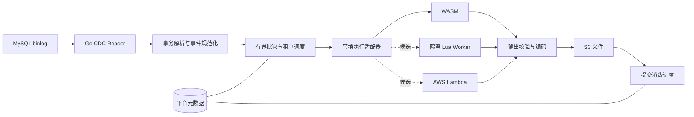

# Go ETL 服务设计

> 实现状态：当前已实现的是 [本地 MVP](user-guide.md)。本文保留初始架构方案；其中 WASM/S3/Iceberg/PostgreSQL 等不等于本次已交付能力。实际 API、Lua 协议和范围以用户文档及 `api/openapi.json` 为准。

状态：初始设计，尚未实现。资料核验日期：2026-10-19。

## 1. 产品定位与首版范围

提供面向外部多租户用户的可编程数据管道：持续读取 MySQL binlog，将已提交的数据变更交给用户函数处理，再把结果写入 AWS S3。服务主体使用 Go。

用户体验类似于“CDC + 函数 + 存储”：用户配置数据源、订阅表、转换代码和 S3 目标；平台负责持续运行、隔离、重试和消费进度。典型需求是字段映射、筛选、脱敏、类型规范化，以及将一条记录拆成多条。

首版约定：

- 只消费指定起点之后的增量，不提供初始全量或历史快照。
- 用户函数无状态，只接受数据并返回结果；不调用外部 API、数据库或 AWS 服务。
- 目标为 S3 中的追加变更文件，默认 gzip JSON Lines；不维护数仓当前表。
- 不提供窗口聚合、跨记录持久化状态、跨表关联或事务级业务运算。
- 使用至少一次处理语义，不承诺端到端 exactly-once。
- 优先验证 WASM 后端；Lua 和 Lambda 是同一协议下的候选方案，不要求首版同时实现。

这里的“无状态”也意味着不能依赖批次边界。同一事件即使因配额调整被放进不同批次，仍应生成相同、顺序稳定的输出。

## 2. 整体架构



### 2.1 职责划分

| 组件 | 职责 |
| --- | --- |
| CDC Reader | 复制协议连接、重连、心跳、binlog 轮转、GTID 或 file/position 恢复 |
| 事务解析器 | 缓存到提交边界，解析行事件，维护来源位置和 schema 版本 |
| 调度器 | 租户公平调度、批次划分、背压、配额和流水线状态 |
| 执行适配器 | 按固定代码版本调用后端，统一超时、错误和协议校验 |
| S3 Sink | 添加可信元数据、编码、压缩、上传、记录输出对象 |
| 元数据存储 | 流水线配置、schema 历史、代码摘要、待处理批次、消费进度和所有权 |
| 用户函数 | 逐事件执行纯数据转换，返回零条或多条结果 |

平台元数据采用支持事务和条件更新的数据库，参考实现选 PostgreSQL。它属于平台内部基础设施，不代表用户函数可以访问数据库。数据库凭证、MySQL 凭证和 S3 写入身份均不传入用户执行环境。

首版每条流水线连接一个 MySQL 来源，事务按源顺序处理，同一时刻只提交一个事务；不同流水线可并行。使用租约和递增 fencing token 保护消费进度，旧 worker 丧失所有权后不能继续提交。S3 可能保留旧 worker 的额外文件，由事件标识识别重复。

读取到完整提交事务后才执行转换。事务过大时可使用有界本地暂存，进程故障后从已提交消费进度重读；暂存不是可靠队列。超过配置的事务大小或暂存配额时暂停流水线，不能提交一半事务，也不能无界占用内存或磁盘。

### 2.2 背压与交付边界

不在首版引入 Kafka 等持久化消息系统，MySQL 保留的 binlog 是重读来源。执行或 S3 写入变慢时，限制在途事务、队列长度和暂存大小，再向上游施加背压。binlog 保留期必须覆盖预期最长故障和追赶时间。

S3 的写入顺序不构成下游读取顺序。输出携带事务和事件顺序信息；需要还原源顺序的下游必须依据这些字段处理。

## 3. 标准 CDC 事件与转换协议

以下协议和 ABI 是本项目的拟定设计，不是现有第三方库自带的接口。首版只实现协议 `v1`，不为尚未上线的设计添加兼容分支。

### 3.1 输入

```json
{
  "protocol_version": "v1",
  "batch_id": "batch-001",
  "transform_version": "sha256:example",
  "events": [
    {
      "event_id": "event-001",
      "source_id": "source-001",
      "transaction_id": "24bc7850-2c16-11ef-9f31-0242ac120002:42",
      "row_index": 0,
      "database": "shop",
      "table": "orders",
      "schema_version": "schema-001",
      "op": "insert",
      "source_position": {
        "gtid": "24bc7850-2c16-11ef-9f31-0242ac120002:42",
        "file": "mysql-bin.000123",
        "event_end_position": "4567"
      },
      "columns": {
        "id": {"type": "uint64"},
        "customer_id": {"type": "int64"},
        "amount": {"type": "decimal", "precision": 18, "scale": 2}
      },
      "before": null,
      "after": {
        "id": "18446744073709551615",
        "customer_id": "1001",
        "amount": "128.50"
      }
    }
  ]
}
```

`insert` 使用 `after`，`delete` 使用 `before`，`update` 同时提供前后镜像。事件位置用于追溯，不直接作为已提交消费进度；后者记录完整事务之后的恢复位置或已消费 GTID 集合。

标识生成规则：

- `source_id` 为平台分配的来源逻辑身份；重新建立不连续的数据源时生成新的来源代次。
- 有 GTID 时，事件标识基于来源身份、代次、GTID 和事务内逻辑行序号生成；更新前后镜像算一条逻辑事件。不要把可能随副本改变的 binlog 文件名纳入 GTID 事件标识。
- 无 GTID 时，使用来源身份、代次、binlog 文件、事件位置和行序号；不能假定跨主库切换后标识仍连续。
- `batch_id` 及该批输入事件、执行版本、顺序在首次调用前持久化，重试不重新划分批次。
- 示例标识为便于阅读的占位值；真实标识使用明确字段序列化后的摘要，不依赖进程时间或随机重试编号。

批次可将一个大事务划分为多个调用，但不跨事务。划分同时受事件数和序列化字节数约束；单事件超过上限时暂停并报告，不静默截断。

### 3.2 无损类型约定

| MySQL 数据 | 协议表示 |
| --- | --- |
| 整数，包括 BIGINT/UNSIGNED | 十进制字符串，`columns` 保留类型和有无符号 |
| DECIMAL | 十进制字符串，保留 precision/scale，不经过 float64 |
| FLOAT/DOUBLE | 有限 JSON number；不承诺恢复源文本格式，拒绝 NaN/Infinity |
| 二进制、BIT | Base64 字符串，列描述标记 `encoding: base64` 和位宽等类型信息 |
| DATE/DATETIME/TIME | 保留源语义的字符串；DATETIME 不擅自附加时区，TIME 保留负号与超 24 小时值 |
| TIMESTAMP | 按源类型解码为 UTC 字符串，保留微秒精度；不能从 binlog 事件头补造行时间精度 |
| 零日期等特殊时间 | 保留原始字符串及列类型，不能偷偷变为 null 或合法日期 |
| SQL NULL | JSON null，不能与缺字段混同 |
| MySQL JSON | 作为 JSON 文本字符串传递，避免跨语言自动解码损失内部大整数精度 |
| 字符数据 | 按源字符集无损转为 UTF-8；无法解码时报错，不以替换字符掩盖损坏 |

用户 SDK 提供精确十进制、二进制和 JSON 解析助手；Lua 等使用浮点数表示数值的环境不可直接用 `tonumber` 处理大整数或金额。SDK 也必须保留 null、空数组和空对象的区别。

### 3.3 输出与校验

```json
{
  "protocol_version": "v1",
  "batch_id": "batch-001",
  "results": [
    {
      "event_id": "event-001",
      "records": [
        {
          "before": null,
          "after": {
            "order_id": "18446744073709551615",
            "customer_id": "1001",
            "amount": "128.50"
          }
        }
      ]
    }
  ]
}
```

每条输入必须且只能对应一个 result。过滤用 `records: []` 显式表达；拆分用多条 record，数组下标成为从零开始的 `output_index`。平台拒绝未知或重复事件标识、缺少结果、协议/批次不匹配、非法镜像、超大输出和非 JSON 值。批次失败时不接受部分结果。

输出 record 固定包含 `before` 与 `after`：插入前镜像为 null，删除后镜像为 null，更新两者都是对象。用户可过滤整条事件，但不能伪造操作类型。拆分按前后镜像使用稳定顺序配对；若拆分后集合成员增减需要生成额外插入/删除，则超出首版协议能力，不能简单将这种情况当作普通更新。

平台生成最终 JSONL envelope，包含租户、流水线、来源、事件标识、事务标识、行序号、来源位置、schema 版本、操作类型、转换版本、输出下标与变换后的镜像。用户只控制 record 数据，不能覆盖这些平台字段。

下游可用 `(pipeline_id, event_id, transform_version, output_index)` 识别同一转换版本的重复输出。重新处理新版本属于新的输出世代，不等同于自动替换旧版本；首版不提供自动历史重算。

## 4. 三种执行方式的比较

Lua 是语言，WASM 是编译目标和执行格式，Lambda 是托管执行服务。比较对象分别为“Lua + 隔离 worker”“WASM + wazero”和“Lambda + 租户专属函数”。它们承载相同的转换语义。

| 维度 | Lua | WASM | AWS Lambda |
| --- | --- | --- | --- |
| 用户开发 | 脚本简短，适合字段规则 | Rust、TinyGo 等编译工具链，需要 SDK | 语言和依赖生态丰富，需打包部署 |
| 数据交换 | Go 与 Lua table 转换 | JSON 字节、线性内存与导出函数 | 网络调用和 JSON 请求响应 |
| 调用开销 | 隔离 worker 有 IPC 开销 | 可进程内调用，仍有编码和拷贝 | 网络往返；按需执行考虑冷启动 |
| 隔离 | VM 本身不等于安全边界 | 内存边界和能力白名单，宿主仍需防护 | AWS 管理执行环境，平台管理 IAM、网络和租户边界 |
| 资源治理 | 进程级 CPU/内存限制，超时杀 worker | 线性内存上限、超时、宿主进程和租户配额 | 函数配置、并发、平台调用限流及 AWS 配额 |
| 依赖能力 | 平台提供受限函数库 | 编译进模块，或受控宿主能力 | 支持更多依赖，但首版仍禁止外部 I/O |
| 平台运维 | worker 池、隔离、脚本运行时 | 模块校验、编译缓存、SDK、沙箱 | 部署、版本、角色、VPC、配额和费用治理 |
| 成本结构 | 实例资源、隔离和运维 | 实例资源、编译、隔离和运维 | 请求、计算、日志、网络及可能的预置并发 |
| 倾向场景 | 重视脚本门槛的轻量规则 | 高频、无状态、受限的可编程转换 | 需要丰富语言与依赖，接受远程执行成本 |

推荐先做 WASM 原型，而不是直接宣布最终性能胜出。比较必须使用相同转换、相同输入、相同隔离要求；不能把不隔离的进程内 Lua 与完整 Lambda 部署只比较函数耗时。

## 5. Lua 扩展点如何实现

### 5.1 Go 嵌入 GopherLua，运行在隔离 worker

主服务通过有界 IPC 把批次交给 worker。worker 加载固定摘要的脚本，以独占 `LState` 执行逐事件 `transform(event)`，适配器包装成第 3 节的统一输出。GopherLua 的 `LState` 不支持 goroutine 并发访问；可以共享只读编译结果，不能共享活动状态。[GopherLua 官方说明](https://github.com/yuin/gopher-lua)

用户脚本示例：

```lua
local function project(row)
    return {
        order_id = row.id,
        customer_id = row.customer_id,
        amount = row.amount
    }
end

function transform(event)
    if event.table ~= "orders" then
        return {}
    end

    local before = etl.null
    local after = etl.null
    if event.op ~= "insert" then
        before = project(event.before)
    end
    if event.op ~= "delete" then
        after = project(event.after)
    end
    return {{ before = before, after = after }}
end
```

`etl.null` 是拟提供的 SDK 哨兵，编码为 JSON null；不能用 Lua nil 替代，否则键会消失。适配器知道返回值是记录列表，将空 table 编码为 `[]`；普通数据里的空数组和对象由 SDK 显式构造。示例不依赖尚不存在的业务库，除上述拟定 SDK 约定外仅使用 Lua 基础语法。

加载和限制流程：

1. 校验脚本大小、摘要和语法，编译并缓存只读结果。
2. 创建 `SkipOpenLibs: true` 的 state，仅开放经过审计的纯函数；不能仅开启整个 base/package 库后就认为安全。
3. 不暴露 `os`、`io`、`debug`、动态模块、文件加载、网络、环境变量或任意 Go 对象。精确数值助手同样需要限制输入规模。
4. 使用 `SetContext` 处理 Lua 执行超时；Go 宿主函数也必须接受取消和边界检查。
5. worker 不持有平台凭证，使用进程级内存和 CPU 限额、隔离文件系统、禁止出网及平台元数据访问。单纯启动子进程不满足这些条件。
6. 每批次使用新 state，结束后销毁；超时、内存异常或 worker 崩溃时终止 worker，由主服务按原批次重试。

调用栈和 registry 限制不等同于 Lua 总堆内存硬配额，不能仅靠它们保护多租户主服务。

### 5.2 Lua 解释器运行于 WASM

另一条路径是将选定 Lua 解释器及桥接代码编译为 WASM，用户仍提交 Lua，Go 只加载解释器模块，调用链为：

```text
Go → wazero → Lua 解释器 → 用户脚本
```

这并不意味着直接把任意 Lua 脚本自动编译成高性能 WASM。需要验证解释器编译、禁用系统库、脚本装载和 JSON 桥接，并把解释器占用计入内存和启动预算。版本身份包含解释器、桥接 SDK 和脚本摘要；超时关闭整个模块。

这条路径可以结合 Lua 的易用性与 WASM 的执行边界，但多一层解释，性能和维护成本需单独测试。首版不同时实现两条 Lua 路径。

## 6. WASM 扩展点如何实现

### 6.1 用户侧与宿主侧

用户使用 SDK 编写逐事件纯函数，SDK 处理批次、JSON 和镜像编码，再编译成 `.wasm`。第一份 SDK 参考实现选择 Rust；TinyGo 支持需单独验证编译目标、导出函数和运行时初始化，不能把“能编译成 WASM”当作“符合本项目 ABI”。

Go 使用 wazero 编译并加载模块。先校验模块大小、imports、exports、ABI 版本和内存声明，再进入执行路径；编译阶段也要限制并发与资源，不能只限制运行阶段。

拟定 `wasm32` ABI：

```text
export memory
export abi_version() -> i32                  // returns 1
export alloc(len: i32) -> i32                // nonzero pointer
export dealloc(ptr: i32, len: i32)
export transform(ptr: i32, len: i32) -> i64   // high 32 bits: ptr; low: len
```

输入和输出都是第 3 节的 UTF-8 JSON。SDK 管理输入、输出两块独立内存，输出不能引用输入；返回值按无符号位段解释，宿主不能用带符号整数直接计算偏移。

```text
验证并编译模块（按摘要缓存 CompiledModule）
  → 创建本批独享实例，校验 abi_version
  → alloc 输入空间，检查指针与长度，再写入输入字节
  → transform，解包输出指针和长度
  → 检查范围、溢出和输出上限，将结果复制到宿主
  → 校验 JSON 和批次协议
  → 成功时释放输入/输出内存，关闭实例
```

指针越界、输入输出重叠、长度溢出、trap 和非法 JSON 都视为批次失败。清理函数也执行不可信代码，必须有超时；异常路径直接关闭实例，不要求继续调用 guest 的 `dealloc`。v1 每批创建新实例，只复用编译结果，避免全局变量、线性内存或缓存跨调用泄漏和影响重放。

### 6.2 wazero 配置与能力边界

以下为资源配置示意，不是完整服务代码：

```go
runtimeConfig := wazero.NewRuntimeConfig().
    WithMemoryLimitPages(1024).
    WithCloseOnContextDone(true)
runtime := wazero.NewRuntimeWithConfig(ctx, runtimeConfig)
defer runtime.Close(ctx)
```

1024 页对应 64 MiB 线性内存，仅为原型起点。`WithCloseOnContextDone(true)` 配合有截止时间的 context 才能终止执行中的 WASM，取消后模块会关闭，不能放回实例池。线性内存上限不包含宿主 JSON、编译代码、运行时栈等全部进程资源，因此仍要限制 worker 总内存和并发。[wazero RuntimeConfig](https://pkg.go.dev/github.com/tetratelabs/wazero#RuntimeConfig)

v1 优先使用不需要 imports 的模块，不默认注册完整 WASI。需要日志时只增加受限、限量、按租户标记的宿主函数；任何宿主函数都要验证指针、长度、配额和取消。不提供文件系统、网络、时间、随机数、环境变量、云凭证或平台对象访问。

外部多租户部署使用独立执行 worker 作为额外进程边界，worker 不持有主服务凭证。WASM 沙箱不代替操作系统资源限制，也不保证宿主实现没有漏洞。

## 7. AWS Lambda 扩展点如何实现

### 7.1 调用与用户代码

平台为每个租户的转换创建独立函数，发布不可变版本；批次固定到带数字版本的 qualified ARN，不使用 `$LATEST` 或可变 alias 作为重放身份。部署包摘要、运行时配置和版本一并记录。版本固定仍不能保证 AWS 管理的运行时内部实现永远不变，必须保留回放验收。[Lambda 执行环境](https://docs.aws.amazon.com/lambda/latest/dg/lambda-runtime-environment.html)

Go 使用 AWS SDK for Go v2 调用 `Invoke`，设置 `InvocationType: RequestResponse`，请求和响应沿用统一协议。检查调用错误、`FunctionError` 和响应体；HTTP 成功不代表用户函数成功。[Invoke API](https://docs.aws.amazon.com/lambda/latest/api/API_Invoke.html)

Python handler 示例，无需外部依赖：

```python
def project(row):
    if row is None:
        return None
    return {
        "order_id": row["id"],
        "customer_id": row["customer_id"],
        "amount": row["amount"],
    }


def handler(request, context):
    results = []
    for event in request["events"]:
        records = []
        if event["table"] == "orders":
            records.append({
                "before": project(event["before"]),
                "after": project(event["after"]),
            })
        results.append({"event_id": event["event_id"], "records": records})
    return {
        "protocol_version": request["protocol_version"],
        "batch_id": request["batch_id"],
        "results": results,
    }
```

数据由平台统一写入 S3，函数执行角色不授予目标桶写权限。用户代码使用与 Lua 示例相同的镜像映射，保留字符串金额和整数。

### 7.2 限制、重试和隔离

普通缓冲式同步调用的请求与响应各受 6 MB 限制。平台按更保守的字节预算分批，并限制输出膨胀；6 MB 不能直接解释为可用原始行数据大小。普通按需 Lambda 函数单次执行最长 900 秒，但 ETL 默认预算远小于此值；本设计不采用响应流或 Lambda Managed Instances 的其他限额模型。[Lambda 配额](https://docs.aws.amazon.com/lambda/latest/dg/gettingstarted-limits.html)

同步函数错误由 Go 服务按策略处理，不能依赖异步调用的自动重试规则。客户端超时只代表未拿到结果，不能证明远端函数已停止；应允许晚到结果被丢弃，并将可能重叠的调用计入限流与费用预算。[Lambda 重试行为](https://docs.aws.amazon.com/lambda/latest/dg/invocation-retries.html)

每个租户独立函数、日志组、最小权限执行角色和并发限制。平台调用身份只获准调用相应函数版本。需要将纯转换约定落实为网络和 IAM 限制：专用私有子网，无公网/NAT/其他可用出口，不提供业务 VPC endpoint；安全组禁止业务出站，并核查 IPv6、DNS 和平台网络路径，不能只靠“部署在 VPC 中”判断无法出网。若安全要求包含 DNS 等数据外传路径，还须配置并验证 DNS 防护；无法证明满足边界时不能开放该后端。[Lambda VPC 网络](https://docs.aws.amazon.com/lambda/latest/dg/configuration-vpc-internet.html)

Lambda 环境可能被后续调用复用，平台不能像关闭本地 WASM 实例那样主动销毁单次环境。必须禁止依赖全局变量、`/tmp` 和后台任务，SDK 不能承诺消除任意用户代码的隐式状态；通过重复调用、换批次和冷/热环境测试检查一致性。若要求严格证明每批从全新状态执行，则首版 Lambda 不满足该要求，保留为候选后端。[Lambda 最佳实践](https://docs.aws.amazon.com/lambda/latest/dg/best-practices.html)

## 8. 持久化、版本与故障恢复

### 8.1 事务提交过程

1. 从最后已提交位置读取，获取完整事务及可用的历史 schema，生成标准事件。
2. 持久化待处理事务、批次计划、输入边界和固定转换版本；元数据写入失败时不调用函数。
3. 顺序处理批次并验证输出，给输出添加平台 envelope。
4. 形成完整 gzip 文件并上传 S3，记录对象键、摘要、大小和事务内批次状态。
5. 该事务全部批次完成后，在元数据数据库中原子更新事务完成状态和消费进度，并校验当前 fencing token。

已过滤为空的批次持久化零输出完成记录，不制造空数据文件。不能因为没有 S3 对象就永远阻止进度推进。没有订阅表行变更的事务也可以在安全提交边界推进进度。

消费进度和 S3 不在同一个数据库事务里。上传成功、元数据尚未落库就崩溃时可能再次执行和写出文件，因此语义为至少一次。用户应编写确定性函数，平台也不能因为“无外部 I/O”就假定所有用户函数天然确定。

### 8.2 S3 布局和可见性

参考路径：

```text
tenant=<tenant_id>/pipeline=<pipeline_id>/generation=<generation>/
  source_date=<YYYY-MM-DD>/tx=<transaction_digest>/batch=<batch_id>/part=<attempt_id>.jsonl.gz
```

日期由已记录的源事件时间确定，重试不使用当前墙钟重新分区。路径中的身份由平台生成并校验，不让用户字符串直接拼接到租户前缀。输出仅在完整文件上传成功后视为持久化；多段上传中断需要清理未完成上传。

首版使用独立尝试对象，失败和重放可能留下额外完整文件。平台元数据记录已知成功对象，但直接枚举 S3 的下游仍可能看到重复或未提交事务的部分文件；只有在后续批次完成后该事务才完整。

“消费进度按完整事务提交”并不意味着多个 S3 对象原子可见。要求事务原子可见的下游需后续增加 commit manifest 并只消费 manifest 引用对象，或接入具有事务语义的湖表。后续幂等写入可评估持久化输出计划、确定性对象键与条件写入，但不能只靠事件 ID 或对象命名宣布 exactly-once。

### 8.3 重试、暂停和版本切换

网络、节流和暂时性 S3/调用错误，使用有上限的指数退避与抖动；原型默认最多 3 次调用尝试，超过后暂停该流水线。协议错误、非法 schema、超限和确定性函数错误直接暂停。记录错误类型与事件/批次标识，不默认保存含敏感数据的完整 payload。

恢复时先检查已持久化的批次状态，未知完成情况可重放，事件 ID 和代码版本不变。用户修改错误代码不能偷偷覆盖正在重试的版本：通过显式修复操作，为尚未提交的事务建立新输出世代，记录旧尝试与新版本关系；旧文件不会自动消失。常规版本切换等待在途事务完成，在下一个事务边界启用，不能同一事务混用版本。

首版暂停不等于跳过。若待处理位置已不在源 binlog 中，进入 `NEEDS_RESEED` 并报告缺口；不自动切到最新位置。用户只能明确创建带新起点的输出世代，或通过后续全量/归档恢复能力补齐。

## 9. MySQL 接入前提与 schema 边界

参考支持目标为 MySQL 8.0/8.4、InnoDB 普通已提交事务；MariaDB、XA 和其他存储引擎不作为首版已支持能力。CDC 库优先评估 `go-mysql-org/go-mysql/replication`，其复制接口支持位置和 GTID 起点。实现时固定依赖版本并进行兼容性测试，不直接跟随浮动分支。[go-mysql 官方项目](https://github.com/go-mysql-org/go-mysql)

接入检查包括：

- 开启 binlog，采用 `binlog_format=ROW` 和 `binlog_row_image=FULL`。配置项并不能替代对实际读到事件格式的检查；缺失所需镜像则暂停。
- 使用独立复制账号、TLS 和唯一复制 `server_id`。读取复制流需要复制权限；查询位置、元数据的额外权限按实际命令授予，不使用管理员账号。MySQL 的复制账号权限见[官方说明](https://dev.mysql.com/doc/refman/8.4/en/replication-howto-repuser.html)。
- 优先 GTID；未启用时使用 file/position，首次起点必须是已验证的事务边界。检查点恢复记录的是已消费事务之后的位置。
- 订阅表过滤由平台在生成用户输入前完成，但仍需读取事务边界；源复制账号可见范围不等于脚本可以获得的范围。

FULL 镜像、ROW 格式与 binlog 保留配置参见 [MySQL binlog 选项](https://dev.mysql.com/doc/refman/8.4/en/replication-options-binary-log.html)。

列名和类型不能只依赖“当前 information_schema + 任意旧 binlog”拼接。首次从当前已验证位置启动时，采集匹配的 schema 基线，检查初始化期间 DDL 竞争；不能确认一致时拒绝启动。从历史位置启动必须提供对应的 schema 基线/历史，首版不承诺自动还原历史结构。

持久化 schema 版本及生效位置，重放使用历史版本。监测到订阅表的 DDL、RENAME、DROP、TRUNCATE 或无法识别的结构变更时，在安全边界暂停，不伪装为普通行更新；恢复前注册并验证新 schema。TRUNCATE 不会被当作逐行 delete 输出，用户需要另行处理下游重建。首版不实现完整 DDL 自动演进。

## 10. 初始配额、运维与成本评估

以下是可调整的原型默认值，不是已验证的生产容量承诺。变更配额时不能改变已持久化的批次计划。

| 项目 | 原型默认值 |
| --- | --- |
| 单次调用输入 | 最多 500 事件且 JSON 编码后不超过 1 MiB |
| 单次调用输出 | JSON 编码后不超过 4 MiB，单事件最多 100 条记录 |
| 单次转换时间 | 5 秒，包含模块初始化和用户函数执行 |
| WASM 线性内存 | 64 MiB，编译与 worker 总内存另外限制 |
| Lua/WASM worker 总内存 | 初始 256 MiB，超限销毁，基准后调整 |
| Lambda 内存及超时 | 初始 256 MiB / 5 秒；调用方网络截止时间另留传输余量 |
| 流水线执行并发 | 1 个批次；租户初始最多 4 条活跃流水线并公平调度 |
| 单事务暂存上限 | 128 MiB，超限暂停；在途事务数为 1 |
| 重试 | 暂时性错误最多 3 次调用尝试，计入首次调用 |

输入和输出上限独立约束。无法预判输出是否膨胀时仍由执行环境和宿主写入接口实施硬边界；不能等在主服务中完整分配巨大结果后才检查长度。Lambda 平台响应上限与本项目上限不是同一个机制。

监控至少包含：源端可观测延迟、消费位置、队列与暂存占用、输入输出字节/记录数、函数耗时、初始化/编译耗时、超时/trap/拒绝次数、重试、S3 延迟与错误、暂停时长、租户配额使用和 binlog 保留风险。日志关联租户、流水线、事务、事件、批次和转换版本，默认不输出用户行值。不能将低精度 binlog 时间戳计算出的延迟当作精确行提交延迟。

费用评估按同等负载与完整部署计算：

- Lua/WASM：常驻与峰值 CPU/内存、隔离 worker、编译/启动、元数据、S3、日志及维护成本。
- Lambda：调用次数约为事件量除以平均批次大小，再加失败重试；计算量由分配内存和计费执行时长决定，还需评估日志、网络和预置并发。不要只按请求次数估价。
- S3：文件大小、请求次数、压缩率和生命周期；事务边界可能产生小文件，后续可增加独立压实任务，不能为减少小文件破坏提交语义。

Lambda 价格因区域、架构、用量和并发模式而异，采用部署时的[官方价格](https://aws.amazon.com/lambda/pricing/)计算。文档不固定单价，也不预设 WASM 必然便宜或更快。

## 11. 原型顺序与验收

### 11.1 实施顺序

1. 先实现标准事件与协议校验器，构造可回放样例，验证精确类型和逐事件语义。
2. 实现一个 WASM SDK 和受限执行 worker，验证取消、内存、输出边界与跨租户隔离。
3. 接入 MySQL、元数据和 S3，打通提交、暂停和恢复，再做故障注入。
4. 使用同一份样例实现隔离 Lua、Lambda 的小型对比原型，依据开发体验、隔离结果和成本决定是否增加正式后端。

### 11.2 验收场景

| 类别 | 场景与通过条件 |
| --- | --- |
| 基本转换 | insert/update/delete、跨表过滤、全过滤、稳定拆分；镜像、顺序和平台元数据正确 |
| 精度 | 最大 unsigned BIGINT、负数、DECIMAL、微秒时间、零日期、二进制、JSON 内大整数及 NULL 均无静默精度损失 |
| 协议 | 缺失/重复/伪造事件 ID、错误批次、非法镜像、空数组/对象混淆、超大输入输出均被拒绝，进度不前移 |
| 执行限制 | 无限循环、初始化死循环、内存增长、深递归、日志洪泛、越界指针、trap 和宿主函数阻塞不能拖垮其他租户 |
| 纯转换 | 同一事件换批次、重复调用和更换实例结果一致；尝试访问文件、网络、DNS、环境变量、凭证和平台元数据被阻止 |
| 故障恢复 | S3 上传失败、超时但远端成功、写对象后崩溃、元数据失败、提交前后重启：无静默跳过，重复可以识别 |
| 事务 | 多批大事务和零输出事务只有全部完成才提交；超过暂存上限暂停；直接读 S3 的部分可见性符合文档边界 |
| 所有权 | worker 租约过期后继续运行不能推进进度；新 worker 可恢复；多余输出可以识别 |
| 版本与 schema | 正常切版仅在事务边界；失败修复有新世代；DDL 暂停；旧 binlog 不使用新 schema 猜测解码 |
| 源恢复 | 轮转、重连、GTID/file-position 恢复、位置不连续与日志过期分别正确处理，缺口不自动跳过 |
| 租户隔离 | A 的代码、日志、状态、目标桶权限与 B 隔离；A 超时或超配额时 B 可持续处理 |
| Lambda | `FunctionError`、节流、冷/热调用、客户端超时与晚到结果、响应超限、版本固定均按协议处理 |

### 11.3 性能与成本实验

对简单映射、脱敏、精确数值处理、解析和拆分分别测试。覆盖小行、大行、事务大小分布、不同批次、租户数量以及突发流量。对比完整部署的端到端吞吐、p50/p95/p99 延迟、CPU、总内存、编译/冷启动、故障恢复时间、压缩率、S3 文件数量和每百万输入事件总成本。

记录工具链、依赖版本、机器规格、AWS 区域、测试数据和冷/热条件。生产吞吐、延迟 SLO 与最终配额在取得真实负载和实验数据后确定；首版设计不编造容量指标。

## 12. 官方资料与核验说明

以下来源于 2026-10-19 核验；库版本、AWS 配额和价格在实现及部署前再次检查。正文中的协议、默认配额和架构取舍是项目设计，不是第三方官方保证。

| 主题 | 官方来源 |
| --- | --- |
| Go binlog 复制库 | [go-mysql](https://github.com/go-mysql-org/go-mysql) |
| Lua state、标准库和取消 | [GopherLua](https://github.com/yuin/gopher-lua) |
| WASM 内存限制及取消 | [wazero RuntimeConfig](https://pkg.go.dev/github.com/tetratelabs/wazero#RuntimeConfig) |
| MySQL ROW/FULL 与保留 | [Binary Logging Options](https://dev.mysql.com/doc/refman/8.4/en/replication-options-binary-log.html) |
| 复制账号 | [Creating a User for Replication](https://dev.mysql.com/doc/refman/8.4/en/replication-howto-repuser.html) |
| Lambda 同步调用与错误 | [Invoke](https://docs.aws.amazon.com/lambda/latest/api/API_Invoke.html) |
| Lambda 调用大小与执行配额 | [Lambda quotas](https://docs.aws.amazon.com/lambda/latest/dg/gettingstarted-limits.html) |
| Lambda 重试 | [Understanding retry behavior](https://docs.aws.amazon.com/lambda/latest/dg/invocation-retries.html) |
| Lambda 复用和无状态要求 | [Best practices](https://docs.aws.amazon.com/lambda/latest/dg/best-practices.html)、[Execution environment](https://docs.aws.amazon.com/lambda/latest/dg/lambda-runtime-environment.html) |
| Lambda 网络 | [VPC internet access](https://docs.aws.amazon.com/lambda/latest/dg/configuration-vpc-internet.html) |
| Lambda 费用 | [AWS Lambda Pricing](https://aws.amazon.com/lambda/pricing/) |
