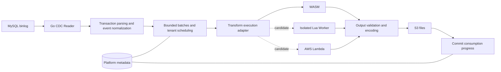

# Go ETL Service Design

> Implementation status: what is currently implemented is the [local MVP](user-guide.md). This document preserves the original architecture proposal; WASM/S3/Iceberg/PostgreSQL and similar items here do not equal the capabilities delivered in this round. The actual API, Lua protocol, and scope are defined by the user guide and `api/openapi.json`.

Status: initial design, not implemented. Reference verification date: 2026-10-19.

## 1. Product Positioning and First-Version Scope

Provide a programmable data pipeline for external multi-tenant users: continuously read MySQL binlog, hand committed data changes to user functions for processing, and write the results to AWS S3. The service is implemented primarily in Go.

The user experience resembles "CDC + functions + storage": users configure the data source, subscribed tables, transform code, and S3 destination; the platform handles continuous operation, isolation, retries, and consumption progress. Typical needs are field mapping, filtering, masking, type normalization, and splitting one record into multiple records.

First-version commitments:

- Only consume increments after a designated starting point; no initial full load or historical snapshot is provided.
- User functions are stateless: they only accept data and return results; they must not call external APIs, databases, or AWS services.
- The destination is append-only change files in S3, gzip JSON Lines by default; no materialized current-table warehouse is maintained.
- No window aggregation, no persisted state across records, no cross-table joins, and no transaction-level business computation.
- At-least-once processing semantics; no end-to-end exactly-once is promised.
- Prioritize validating the WASM backend; Lua and Lambda are candidates under the same protocol, and the first version is not required to implement both.

"Stateless" here also means no reliance on batch boundaries. The same event must produce identical, order-stable output even if it is placed in different batches due to quota adjustments.

## 2. Overall Architecture



### 2.1 Responsibility Split

| Component | Responsibilities |
| --- | --- |
| CDC Reader | Replication protocol connection, reconnection, heartbeats, binlog rotation, GTID or file/position recovery |
| Transaction parser | Buffer to commit boundary, parse row events, maintain source position and schema versions |
| Scheduler | Fair tenant scheduling, batch partitioning, backpressure, quotas, and pipeline state |
| Execution adapter | Invoke backends pinned to a fixed code version; unify timeouts, errors, and protocol validation |
| S3 Sink | Add trusted metadata, encode, compress, upload, record output objects |
| Metadata store | Pipeline configs, schema history, code digests, pending batches, consumption progress, and ownership |
| User function | Per-event pure data transformation, returning zero or more results |

Platform metadata uses a database that supports transactions and conditional updates; the reference implementation is PostgreSQL. It is internal platform infrastructure and does not mean user functions can access databases. Database credentials, MySQL credentials, and S3 write identities are never passed into the user execution environment.

In the first version, each pipeline connects to a single MySQL source; transactions are processed in source order, with only one transaction committed at a time; different pipelines may run in parallel. Consumption progress is protected by leases plus an incrementing fencing token; an old worker that loses ownership cannot keep committing. S3 may retain extra files from an old worker; duplicates are identified by event identity.

Transforms run only after a fully committed transaction is read. When a transaction is too large, bounded local staging may be used; after a process failure, data is re-read from the last committed consumption progress; staging is not a reliable queue. When a transaction exceeds the configured size or staging quota, the pipeline is paused: it must not commit half a transaction, nor consume memory or disk without bound.

### 2.2 Backpressure and Delivery Boundary

The first version does not introduce a persistent messaging system such as Kafka; binlog retained by MySQL is the re-read source. When execution or S3 writes slow down, in-flight transactions, queue length, and staging size are limited first, then backpressure is applied upstream. The binlog retention period must cover the expected longest failure and catch-up time.

S3 write order does not constitute downstream read order. Outputs carry transaction and event ordering information; downstreams that need to reconstruct source order must process based on these fields.

## 3. Standard CDC Event and Transform Protocol

The protocol and ABI below are the proposed design of this project, not interfaces shipped by an existing third-party library. The first version implements only protocol `v1`; no compatibility branches are added for designs that are not yet live.

### 3.1 Input

```json
{
  "protocol_version": "v1",
  "batch_id": "batch-001",
  "transform_version": "sha256:example",
  "events": [
    {
      "event_id": "event-001",
      "source_id": "source-001",
      "transaction_id": "24bc7850-2c16-11ef-9f31-0242ac120002:42",
      "row_index": 0,
      "database": "shop",
      "table": "orders",
      "schema_version": "schema-001",
      "op": "insert",
      "source_position": {
        "gtid": "24bc7850-2c16-11ef-9f31-0242ac120002:42",
        "file": "mysql-bin.000123",
        "event_end_position": "4567"
      },
      "columns": {
        "id": {"type": "uint64"},
        "customer_id": {"type": "int64"},
        "amount": {"type": "decimal", "precision": 18, "scale": 2}
      },
      "before": null,
      "after": {
        "id": "18446744073709551615",
        "customer_id": "1001",
        "amount": "128.50"
      }
    }
  ]
}
```

`insert` uses `after`, `delete` uses `before`, and `update` provides both before and after images. Event positions are used for tracing and are not directly the committed consumption progress; the latter records the recovery position after a complete transaction, or the consumed GTID set.

Identity generation rules:

- `source_id` is the platform-assigned logical identity of a source; re-establishing a discontinuous data source generates a new source generation.
- With GTID enabled, event identity is derived from source identity, generation, GTID, and the logical row sequence within the transaction; before and after images of an update count as one logical event. Do not include the binlog file name—which may change on replicas—in GTID event identity.
- Without GTID, use source identity, generation, binlog file, event position, and row sequence; do not assume identity remains continuous across primary failovers.
- The `batch_id` and the batch's input events, execution version, and ordering are persisted before the first invocation; retries do not re-partition the batch.
- Example identities are placeholders for readability; real identities use digests over explicit field serialization and do not depend on process time or random retry numbers.

A batch may split a large transaction into multiple invocations, but never across transactions. Partitioning is constrained by both event count and serialized byte size; when a single event exceeds the limit, the pipeline pauses and reports instead of silently truncating.

### 3.2 Lossless Type Conventions

| MySQL data | Protocol representation |
| --- | --- |
| Integers, including BIGINT/UNSIGNED | Decimal strings; `columns` retains the type and signedness |
| DECIMAL | Decimal string preserving precision/scale; never routed through float64 |
| FLOAT/DOUBLE | Finite JSON numbers; no promise to restore the original textual format; NaN/Infinity rejected |
| Binary, BIT | Base64 strings; column description marks `encoding: base64` and bit width and other type info |
| DATE/DATETIME/TIME | Strings preserving source semantics; DATETIME must not have a time zone attached arbitrarily; TIME keeps the sign and values beyond 24 hours |
| TIMESTAMP | Decoded per the source type into a UTC string, preserving microsecond precision; row-level time precision must not be fabricated from binlog event headers |
| Zero dates and other special time values | Original string and column type preserved; must not be silently converted to null or a valid date |
| SQL NULL | JSON null; must not be conflated with a missing field |
| MySQL JSON | Passed as a JSON text string, avoiding cross-language auto-decoding that loses precision of large internal integers |
| Character data | Losslessly converted to UTF-8 per the source charset; undecodable input is an error, not masked with replacement characters |

The user SDK provides exact decimal, binary, and JSON parsing helpers; environments that represent numbers as floats, such as Lua, must not use `tonumber` on large integers or monetary amounts. The SDK must also preserve the distinction between null, empty arrays, and empty objects.

### 3.3 Output and Validation

```json
{
  "protocol_version": "v1",
  "batch_id": "batch-001",
  "results": [
    {
      "event_id": "event-001",
      "records": [
        {
          "before": null,
          "after": {
            "order_id": "18446744073709551615",
            "customer_id": "1001",
            "amount": "128.50"
          }
        }
      ]
    }
  ]
}
```

Each input must correspond to exactly one result. Filtering is expressed explicitly with `records: []`; splitting uses multiple records, and the array index becomes a zero-based `output_index`. The platform rejects unknown or duplicate event identities, missing results, protocol/batch mismatches, illegal images, oversized outputs, and non-JSON values. When a batch fails, partial results are not accepted.

Each output record always contains both `before` and `after`: for an insert the before image is null, for a delete the after image is null, and for an update both are objects. Users may filter out an entire event but cannot forge operation types. Split pairs before/after images in a stable order; if splitting requires adding or removing members of a set—generating extra inserts/deletes—that exceeds first-version protocol capabilities and must not be treated as an ordinary update.

The platform generates the final JSONL envelope, including tenant, pipeline, source, event identity, transaction identity, row index, source position, schema version, operation type, transform version, output index, and transformed images. Users only control record data and cannot override these platform fields.

Downstream can use `(pipeline_id, event_id, transform_version, output_index)` to identify duplicate outputs of the same transform version. Re-processing a new version is a new output generation and does not automatically replace the old version; the first version does not provide automatic backfill of history.

## 4. Comparing the Three Execution Options

Lua is a language, WASM is a compilation target and execution format, and Lambda is a managed execution service. The comparison objects are "Lua + isolated worker", "WASM + wazero", and "Lambda + tenant-dedicated functions". They all carry the same transform semantics.

| Dimension | Lua | WASM | AWS Lambda |
| --- | --- | --- | --- |
| User development | Short scripts, suited to field rules | Rust, TinyGo and other compiled toolchains, SDK required | Rich language and dependency ecosystem, packaging and deployment needed |
| Data exchange | Go-to-Lua table conversion | JSON bytes, linear memory, and exported functions | Network calls and JSON request/response |
| Invocation overhead | Isolated worker has IPC overhead | In-process invocation possible, still encoding and copying | Network round trips; cold starts with on-demand execution |
| Isolation | The VM itself is not a security boundary | Memory boundaries and capability whitelists; host still needs hardening | AWS-managed execution environment; platform manages IAM, networking, and tenant boundaries |
| Resource governance | Process-level CPU/memory limits, kill worker on timeout | Linear memory cap, timeout, host process and tenant quotas | Function configuration, concurrency, platform call throttling, and AWS quotas |
| Dependency capabilities | Platform provides a restricted function library | Compiled into module, or controlled host capabilities | More dependencies supported, but external I/O is still banned in the first version |
| Platform operations | Worker pool, isolation, script runtime | Module validation, compile cache, SDK, sandbox | Deployment, versions, roles, VPC, quotas, and cost governance |
| Cost structure | Instance resources, isolation, and operations | Instance resources, compilation, isolation, and operations | Requests, compute, logs, networking, and possibly provisioned concurrency |
| Preferred scenarios | Lightweight rules where script accessibility matters | High-frequency, stateless, restricted programmable transforms | Rich languages and dependencies, accepting remote execution costs |

Build the WASM prototype first rather than declaring a final performance winner upfront. Comparisons must use the same transforms, same inputs, and same isolation requirements; do not compare non-isolated in-process Lua against a full Lambda deployment on function time alone.

## 5. How the Lua Extension Point Would Be Implemented

### 5.1 Embedding GopherLua in Go, Running in an Isolated Worker

The main service hands batches to workers over bounded IPC. A worker loads a script pinned by digest and executes a per-event `transform(event)` on an exclusive `LState`; the adapter wraps results into the unified output of Section 3. GopherLua's `LState` does not support concurrent goroutine access; compiled read-only results may be shared, live state may not. [GopherLua official notes](https://github.com/yuin/gopher-lua)

Example user script:

```lua
local function project(row)
    return {
        order_id = row.id,
        customer_id = row.customer_id,
        amount = row.amount
    }
end

function transform(event)
    if event.table ~= "orders" then
        return {}
    end

    local before = etl.null
    local after = etl.null
    if event.op ~= "insert" then
        before = project(event.before)
    end
    if event.op ~= "delete" then
        after = project(event.after)
    end
    return {{ before = before, after = after }}
end
```

`etl.null` is a proposed SDK sentinel encoded as JSON null; it cannot be replaced by Lua nil, which would drop the key. The adapter knows the return value is a list of records and encodes an empty table as `[]`; empty arrays and objects in ordinary data are constructed explicitly via the SDK. The example relies on no nonexistent business library; beyond the proposed SDK conventions above it uses only plain Lua syntax.

Loading and restriction flow:

1. Validate script size, digest, and syntax; compile and cache the read-only result.
2. Create a `SkipOpenLibs: true` state and expose only audited pure functions; safety cannot be claimed just by enabling the whole base/package libraries.
3. Do not expose `os`, `io`, `debug`, dynamic modules, file loading, networking, environment variables, or arbitrary Go objects. Exact numeric helpers also require input size limits.
4. Use `SetContext` for Lua execution timeouts; Go host functions must also accept cancellation and boundary checks.
5. The worker holds no platform credentials; use process-level memory and CPU limits, an isolated file system, no outbound network, and no access to platform metadata. Merely spawning a subprocess does not satisfy these conditions.
6. Use a fresh state per batch and destroy it afterwards; on timeout, memory anomalies, or worker crash, terminate the worker and let the main service retry the original batch.

Call stack and registry limits are not equivalent to a hard quota on Lua's total heap memory; they alone cannot protect a multi-tenant main service.

### 5.2 Running a Lua Interpreter inside WASM

Another path compiles a chosen Lua interpreter plus bridging code into WASM; users still submit Lua, and Go only loads the interpreter module. The call chain is:

```text
Go → wazero → Lua interpreter → user script
```

This does not mean arbitrary Lua scripts are automatically compiled into high-performance WASM. Interpreter compilation, disabled system libraries, script loading, and the JSON bridge must be validated, and interpreter footprint must count toward memory and startup budgets. Version identity includes the interpreter, bridge SDK, and script digest; timeouts shut down the entire module.

This path combines Lua's ease of use with WASM's execution boundary, but adds an interpretation layer; performance and maintenance costs need separate testing. The first version does not implement both Lua paths at once.

## 6. How the WASM Extension Point Would Be Implemented

### 6.1 User Side and Host Side

Users write per-event pure functions with an SDK; the SDK handles batches, JSON, and image encoding, then compiles to `.wasm`. The first SDK reference implementation is Rust; TinyGo support requires separately validating compilation targets, exported functions, and runtime initialization—"compiles to WASM" must not be treated as "conforms to this project's ABI".

Go compiles and loads modules with wazero. Validate module size, imports, exports, ABI version, and memory declarations before entering the execution path; compilation must also limit concurrency and resources, not just the run phase.

Proposed `wasm32` ABI:

```text
export memory
export abi_version() -> i32                  // returns 1
export alloc(len: i32) -> i32                // nonzero pointer
export dealloc(ptr: i32, len: i32)
export transform(ptr: i32, len: i32) -> i64   // high 32 bits: ptr; low: len
```

Both input and output are UTF-8 JSON per Section 3. The SDK manages two independent memory regions for input and output; the output must not reference the input; the return value is interpreted as unsigned bit fields—the host must not compute offsets with signed integers.

```text
Validate and compile module (cache CompiledModule by digest)
  → create a per-batch exclusive instance, validate abi_version
  → alloc input space, check pointer and length, then write input bytes
  → transform, unpack output pointer and length
  → check ranges, overflow, and output caps, copy result to host
  → validate JSON and batch protocol
  → on success, release input/output memory and close the instance
```

Out-of-bounds pointers, input/output overlap, length overflow, traps, and illegal JSON are all batch failures. Cleanup functions also execute untrusted code and must have a timeout; abnormal paths close the instance directly without requiring further guest `dealloc` calls. v1 creates a new instance per batch and reuses only compiled results, avoiding cross-call leakage of globals, linear memory, or caches that would affect replay.

### 6.2 wazero Configuration and Capability Boundaries

The following is a resource configuration sketch, not complete service code:

```go
runtimeConfig := wazero.NewRuntimeConfig().
    WithMemoryLimitPages(1024).
    WithCloseOnContextDone(true)
runtime := wazero.NewRuntimeWithConfig(ctx, runtimeConfig)
defer runtime.Close(ctx)
```

1024 pages correspond to 64 MiB of linear memory, only a starting point for the prototype. `WithCloseOnContextDone(true)` terminates executing WASM only when combined with a context that has a deadline; a cancelled module is closed and cannot be returned to an instance pool. The linear memory cap does not cover all process resources such as host JSON, compiled code, and runtime stacks, so total worker memory and concurrency must still be limited. [wazero RuntimeConfig](https://pkg.go.dev/github.com/tetratelabs/wazero#RuntimeConfig)

v1 prefers modules that need no imports and does not register full WASI by default. If logging is needed, only restricted, rate-limited, tenant-tagged host functions are added; any host function must validate pointers, lengths, quotas, and cancellation. No file system, networking, time, randomness, environment variables, cloud credentials, or platform object access is provided.

For external multi-tenant deployments, dedicated execution workers serve as an additional process boundary, and workers hold no main-service credentials. The WASM sandbox does not replace OS resource limits, nor does it guarantee the host implementation has no vulnerabilities.

## 7. How the AWS Lambda Extension Point Would Be Implemented

### 7.1 Invocation and User Code

The platform creates a dedicated function per tenant's transform and publishes immutable versions; batches are pinned to qualified ARNs with numeric versions, not `$LATEST` or mutable aliases, as the replay identity. Deployment package digests, runtime configuration, and versions are recorded together. Version pinning still cannot guarantee the internals of AWS-managed runtimes never change, so replay acceptance tests must be retained. [Lambda execution environment](https://docs.aws.amazon.com/lambda/latest/dg/lambda-runtime-environment.html)

Go uses AWS SDK for Go v2 to call `Invoke` with `InvocationType: RequestResponse`; requests and responses use the unified protocol. Check invocation errors, `FunctionError`, and the response body; HTTP success does not mean the user function succeeded. [Invoke API](https://docs.aws.amazon.com/lambda/latest/api/API_Invoke.html)

A Python handler example with no external dependencies:

```python
def project(row):
    if row is None:
        return None
    return {
        "order_id": row["id"],
        "customer_id": row["customer_id"],
        "amount": row["amount"],
    }


def handler(request, context):
    results = []
    for event in request["events"]:
        records = []
        if event["table"] == "orders":
            records.append({
                "before": project(event["before"]),
                "after": project(event["after"]),
            })
        results.append({"event_id": event["event_id"], "records": records})
    return {
        "protocol_version": request["protocol_version"],
        "batch_id": request["batch_id"],
        "results": results,
    }
```

Data is written to S3 by the platform; the function execution role is not granted write access to the destination bucket. User code uses the same image mapping as the Lua example, preserving string amounts and integers.

### 7.2 Limits, Retries, and Isolation

Buffered synchronous invocations have a 6 MB limit for both request and response. The platform batches under a more conservative byte budget and limits output amplification; 6 MB must not be read directly as the usable raw row data size. Regular on-demand Lambda functions may run up to 900 seconds per execution, but the ETL default budget is far below this; this design does not adopt response streaming or the quota models of Lambda Managed Instances. [Lambda quotas](https://docs.aws.amazon.com/lambda/latest/dg/gettingstarted-limits.html)

Synchronous function errors are handled by the Go service per policy; the automatic retry rules of asynchronous invocation cannot be relied upon. A client timeout only means no result was received—it does not prove the remote function stopped; late results should be allowed to be discarded, and potentially overlapping invocations must be counted toward throttling and cost budgets. [Lambda retry behavior](https://docs.aws.amazon.com/lambda/latest/dg/invocation-retries.html)

Each tenant has a dedicated function, log group, least-privilege execution role, and concurrency limit. The platform invocation identity is only permitted to invoke the corresponding function version. The pure-transform convention must be enforced as network and IAM restrictions: dedicated private subnets with no public/NAT/other egress, no business VPC endpoints; security groups block business-bound egress, and IPv6, DNS, and platform network paths must be audited—being "deployed in a VPC" alone does not prove no outbound access. If security requirements include data-exfiltration paths such as DNS, DNS protections must also be configured and verified; a backend whose boundary cannot be proven must not be opened. [Lambda VPC networking](https://docs.aws.amazon.com/lambda/latest/dg/configuration-vpc-internet.html)

Lambda environments may be reused by later invocations; the platform cannot actively destroy a single-use environment the way it closes a local WASM instance. Global variables, `/tmp`, and background tasks must be prohibited, but the SDK cannot promise to eliminate implicit state in arbitrary user code; verify consistency via repeated invocations, different batches, and cold/warm environment tests. If strict proof that every batch starts from a fresh state is required, Lambda does not satisfy it in the first version and remains a candidate backend. [Lambda best practices](https://docs.aws.amazon.com/lambda/latest/dg/best-practices.html)

## 8. Persistence, Versioning, and Failure Recovery

### 8.1 Transaction Commit Process

1. Read from the last committed position, obtain the complete transaction and available historical schemas, and produce standard events.
2. Persist the pending transaction, batch plan, input boundaries, and pinned transform version; if the metadata write fails, functions are not invoked.
3. Process batches in order and validate outputs, adding the platform envelope to outputs.
4. Form a complete gzip file and upload to S3, recording the object key, digest, size, and per-batch state within the transaction.
5. After all batches of the transaction complete, atomically update the transaction completion state and consumption progress in the metadata database, and verify the current fencing token.

Batches filtered to empty persist a zero-output completion record and produce no empty data files. Progress must not be blocked forever just because there is no S3 object. Transactions with no row changes in subscribed tables may still advance progress at safe commit boundaries.

Consumption progress and S3 are not in the same database transaction. A crash after a successful upload but before the metadata write may lead to re-execution and duplicate files, so the semantics are at-least-once. Users should write deterministic functions, and the platform must not assume all user functions are naturally deterministic merely because "external I/O is banned."

### 8.2 S3 Layout and Visibility

Reference path layout:

```text
tenant=<tenant_id>/pipeline=<pipeline_id>/generation=<generation>/
  source_date=<YYYY-MM-DD>/tx=<transaction_digest>/batch=<batch_id>/part=<attempt_id>.jsonl.gz
```

The date is determined by the recorded source event time; retries do not re-partition by current wall clock. Identities in the path are generated and validated by the platform; user strings are not concatenated directly into tenant prefixes. Outputs count as persisted only after the complete file upload succeeds; interrupted multipart uploads need cleanup.

The first version uses independent attempt objects; failures and replays may leave extra complete files. Platform metadata records known successful objects, but downstreams that enumerate S3 directly may still see duplicates or partial files of uncommitted transactions; a transaction is complete only after its subsequent batches finish.

"Consumption progress commits per complete transaction" does not imply atomic visibility of multiple S3 objects. Downstreams requiring transactional visibility need a later addition of a commit manifest consuming only manifest-referenced objects, or integration with a lake table that has transaction semantics. Later idempotent writes can be evaluated via persisted output plans, deterministic object keys, and conditional writes—but exactly-once cannot be claimed based on event IDs or object naming alone.

### 8.3 Retries, Pausing, and Version Switching

Network, throttling, and transient S3/invocation errors use bounded exponential backoff with jitter; the prototype defaults to at most 3 invocation attempts, after which the pipeline is paused. Protocol errors, illegal schemas, limit violations, and deterministic function errors pause the pipeline directly. Record the error type and event/batch identity; full payloads containing sensitive data are not saved by default.

On recovery, check persisted batch state first; unknown completion may be replayed with unchanged event IDs and code version. Users fixing faulty code must not silently overwrite the version being retried: through an explicit repair operation, establish a new output generation for transactions not yet committed, recording the relationship between old attempts and the new version; old files do not disappear automatically. Routine version switching waits for in-flight transactions to complete and takes effect at the next transaction boundary; versions must not be mixed within the same transaction.

Pausing in the first version does not mean skipping. If the pending position is no longer in the source binlog, the pipeline enters `NEEDS_RESEED` and reports the gap; it does not automatically jump to the latest position. Users can only explicitly create a new output generation with a new starting point, or backfill via later full-load/archive recovery capabilities.

## 9. MySQL Integration Prerequisites and Schema Boundaries

The reference support target is MySQL 8.0/8.4 with InnoDB normal committed transactions; MariaDB, XA, and other storage engines are not supported capabilities in the first version. The CDC library of choice is `go-mysql-org/go-mysql/replication`, whose replication interface supports position and GTID starting points. Pin dependency versions and run compatibility tests; do not blindly follow floating branches. [go-mysql official project](https://github.com/go-mysql-org/go-mysql)

Integration checks include:

- Binlog enabled with `binlog_format=ROW` and `binlog_row_image=FULL`. Configuration alone does not replace checks on the actual event format read; if required images are missing, pause.
- Use a dedicated replication account, TLS, and a unique replication `server_id`. Reading the replication stream requires replication privileges; additional privileges for querying positions and metadata are granted per actual command, and admin accounts are not used. See the MySQL official documentation for [replication account privileges](https://dev.mysql.com/doc/refman/8.4/en/replication-howto-repuser.html).
- Prefer GTID; when not enabled, use file/position, and the initial starting point must be a verified transaction boundary. Checkpoint recovery records the position after consumed transactions.
- Subscribed-table filtering is done by the platform before generating user input, but transaction boundaries must still be read; what the source replication account can see is not equal to what scripts may obtain.

For FULL row image, ROW format, and binlog retention configuration, see [MySQL binary logging options](https://dev.mysql.com/doc/refman/8.4/en/replication-options-binary-log.html).

Column names and types cannot rely on stitching "current information_schema + arbitrary old binlog" together. When starting first from a current verified position, collect a matching schema baseline and check for DDL races during initialization; refuse to start when consistency cannot be confirmed. Starting from a historical position requires the corresponding schema baseline/history; the first version does not promise automatic reconstruction of historical structure.

Persist schema versions along with their effective positions; replays use historical versions. When DDL, RENAME, DROP, TRUNCATE, or unrecognizable structural changes are detected on subscribed tables, pause at a safe boundary instead of disguising them as ordinary row updates; register and validate the new schema before resuming. TRUNCATE is not emitted as per-row deletes; users need to handle downstream rebuilds separately. The first version does not implement full automatic DDL evolution.

## 10. Initial Quotas, Operations, and Cost Estimation

The following are adjustable prototype defaults, not verified production capacity commitments. Changing quotas must not alter already persisted batch plans.

| Item | Prototype default |
| --- | --- |
| Per-invocation input | Up to 500 events and no more than 1 MiB after JSON encoding |
| Per-invocation output | No more than 4 MiB after JSON encoding, up to 100 records per event |
| Per-invocation transform time | 5 seconds, including module initialization and user function execution |
| WASM linear memory | 64 MiB; compilation and total worker memory limited separately |
| Lua/WASM worker total memory | Initial 256 MiB; destroy on exceed, adjust after benchmarking |
| Lambda memory and timeout | Initial 256 MiB / 5 seconds; caller network deadline leaves additional transport margin |
| Pipeline execution concurrency | 1 batch; a tenant starts with at most 4 active pipelines, fairly scheduled |
| Per-transaction staging cap | 128 MiB, pause on exceed; in-flight transaction count is 1 |
| Retries | Up to 3 invocation attempts for transient errors, counting the first attempt |

Input and output caps are independent constraints. When output amplification cannot be predicted, hard boundaries must still be enforced by the execution environment and host write interfaces; do not wait until a huge result is fully allocated in the main service before checking length. The Lambda platform response cap and this project's caps are not the same mechanism.

Monitoring includes at least: source observable lag, consumption position, queue and staging usage, input/output bytes and record counts, function duration, initialization/compile duration, timeout/trap/rejection counts, retries, S3 latency and errors, pause duration, tenant quota usage, and binlog retention risk. Logs correlate tenant, pipeline, transaction, event, batch, and transform version; user row values are not logged by default. Lag computed from low-precision binlog timestamps must not be treated as exact row commit latency.

Cost estimation is computed for equal load and full deployments:

- Lua/WASM: steady-state and peak CPU/memory, isolated workers, compilation/startup, metadata, S3, logs, and maintenance costs.
- Lambda: invocation count is roughly event volume divided by average batch size, plus failed retries; compute is determined by allocated memory and billed execution duration, plus logs, networking, and provisioned concurrency. Do not price by request count alone.
- S3: file size, request count, compression ratio, and lifecycle; transaction boundaries may create small files, and a separate compaction job can be added later—do not break commit semantics to reduce small files.

Lambda pricing varies by region, architecture, usage, and concurrency mode; use the [official pricing](https://aws.amazon.com/lambda/pricing/) at deployment time. This document does not fix unit prices, nor does it presume WASM is necessarily cheaper or faster.

## 11. Prototype Order and Acceptance

### 11.1 Implementation Order

1. Implement the standard event and protocol validator first, build replayable samples, and verify exact types and per-event semantics.
2. Implement one WASM SDK and a restricted execution worker; verify cancellation, memory, output boundaries, and cross-tenant isolation.
3. Integrate MySQL, metadata, and S3; wire up commit, pause, and recovery; then do failure injection.
4. Using the same samples, build small comparison prototypes of isolated Lua and Lambda, and decide whether to add a formal backend based on development experience, isolation results, and cost.

### 11.2 Acceptance Scenarios

| Category | Scenarios and pass conditions |
| --- | --- |
| Basic transforms | insert/update/delete, cross-table filtering, full filtering, stable splitting; images, ordering, and platform metadata correct |
| Precision | Max unsigned BIGINT, negative numbers, DECIMAL, microsecond times, zero dates, binary, large integers inside JSON, and NULL all without silent precision loss |
| Protocol | Missing/duplicate/forged event IDs, wrong batches, illegal images, empty array/object confusion, oversized inputs/outputs all rejected without progress advancing |
| Execution limits | Infinite loops, initialization loops, memory growth, deep recursion, log flooding, out-of-bounds pointers, traps, and blocked host functions must not take down other tenants |
| Pure transforms | Same event across different batches, repeated invocations, and different instances yields identical results; attempts to access files, network, DNS, environment variables, credentials, and platform metadata are blocked |
| Failure recovery | S3 upload failure, timeout with remote success, crash after writing object, metadata failure, restart before/after commit: no silent skips, duplicates identifiable |
| Transactions | Multi-batch large transactions and zero-output transactions commit only when all batches complete; pause when staging cap exceeded; direct S3 reads see partial visibility consistent with documented boundaries |
| Ownership | A worker whose lease expired cannot advance progress by continuing to run; a new worker can recover; extra outputs are identifiable |
| Versioning and schema | Normal version switch only at transaction boundaries; failed repairs create a new generation; DDL pauses; old binlog is not decoded using new schema guesses |
| Source recovery | Rotation, reconnection, GTID/file-position recovery, position discontinuity, and log expiry each handled correctly; gaps are not auto-skipped |
| Tenant isolation | A's code, logs, state, and destination bucket permissions are isolated from B's; when A times out or exceeds quota, B keeps processing |
| Lambda | `FunctionError`, throttling, cold/warm invocations, client timeouts and late results, response limits, and version pinning all handled per protocol |

### 11.3 Performance and Cost Experiments

Test simple mapping, masking, exact numeric handling, parsing, and splitting separately. Cover small rows, large rows, transaction size distributions, different batches, tenant counts, and bursty traffic. Compare end-to-end throughput of full deployments, p50/p95/p99 latency, CPU, total memory, compile/cold start, recovery time, compression ratio, S3 file count, and total cost per million input events.

Record toolchain, dependency versions, machine specs, AWS region, test data, and cold/warm conditions. Production throughput, latency SLOs, and final quotas are determined after real workloads and experimental data; the first-version design does not fabricate capacity metrics.

## 12. Official Sources and Verification Notes

The following sources were verified on 2026-10-19; library versions, AWS quotas, and prices should be re-checked before implementation and deployment. Protocols, default quotas, and architectural trade-offs in the body of this document are project design decisions, not third-party official guarantees.

| Topic | Official source |
| --- | --- |
| Go binlog replication library | [go-mysql](https://github.com/go-mysql-org/go-mysql) |
| Lua state, standard libraries, and cancellation | [GopherLua](https://github.com/yuin/gopher-lua) |
| WASM memory limits and cancellation | [wazero RuntimeConfig](https://pkg.go.dev/github.com/tetratelabs/wazero#RuntimeConfig) |
| MySQL ROW/FULL and retention | [Binary Logging Options](https://dev.mysql.com/doc/refman/8.4/en/replication-options-binary-log.html) |
| Replication account | [Creating a User for Replication](https://dev.mysql.com/doc/refman/8.4/en/replication-howto-repuser.html) |
| Lambda synchronous invocation and errors | [Invoke](https://docs.aws.amazon.com/lambda/latest/api/API_Invoke.html) |
| Lambda invocation size and execution quotas | [Lambda quotas](https://docs.aws.amazon.com/lambda/latest/dg/gettingstarted-limits.html) |
| Lambda retries | [Understanding retry behavior](https://docs.aws.amazon.com/lambda/latest/dg/invocation-retries.html) |
| Lambda reuse and statelessness requirements | [Best practices](https://docs.aws.amazon.com/lambda/latest/dg/best-practices.html), [Execution environment](https://docs.aws.amazon.com/lambda/latest/dg/lambda-runtime-environment.html) |
| Lambda networking | [VPC internet access](https://docs.aws.amazon.com/lambda/latest/dg/configuration-vpc-internet.html) |
| Lambda pricing | [AWS Lambda Pricing](https://aws.amazon.com/lambda/pricing/) |
